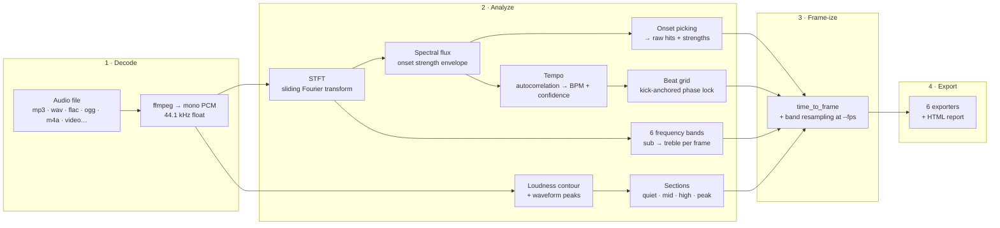

# spectrumalyzer

**Turn any song into animation-ready data.** Give it music — get beats, BPM,
onsets, frequency bands, song sections and loudness, delivered in the exact
format your creative tool speaks: Remotion, HyperFrames, After Effects,
Final Cut / DaVinci Resolve, spreadsheets, or plain JSON.

No subscriptions, no uploads, no cloud. Everything runs locally with two
open-source workhorses: Python + ffmpeg.

---

## Why spectrumalyzer?

Editors and animators don't think in seconds — they think in **frames**.
Most audio tools stop at "here are some timestamps." spectrumalyzer goes the
last mile:

- **Frame-native output** — beats pre-converted to your project's frame rate
  (24 / 25 / 30 / 60 fps), so there's zero runtime math in your compositions.
- **Speaks your tool's dialect** — a React hook for Remotion, a marker script
  for After Effects, an FCPXML for Final Cut and Resolve, a timeline JSON for
  HyperFrames.
- **Musically grounded** — the beat grid is phase-locked to the **kick drum**,
  not to generic loudness spikes, so your cuts land on the beat even when
  hi-hats are louder than the bass.
- **Honest data** — every signal is a real measurement (FFT-based), with
  confidence scores and documented limitations.

---

## How it works — Architecture

spectrumalyzer is a pipeline: **decode → analyze → frame-ize → export**.
Each stage is an independent, testable component.



### The stages in plain language

| Stage | What happens | Why it matters to you |
|---|---|---|
| **Decode** | ffmpeg converts any audio (or video's audio track) to clean mono PCM | You never think about codecs — if ffmpeg plays it, spectrumalyzer reads it |
| **STFT** | The signal is windowed and Fourier-transformed thousands of times | This is where "sound" becomes measurable frequency data |
| **Spectral flux** | Measures how *fast* the spectrum changes between frames | Percussive hits (kicks, snares, clicks) jump out; sustained notes don't |
| **Onset picking** | Adaptive thresholds find the exact moments of impact | Your "hit" effects trigger on real transients, not random loud parts |
| **Tempo** | Autocorrelation finds the repeating pulse; octave confusion is resolved by preferring the DAW-authors' tempo, refined below one frame | BPM you can quantize an edit to |
| **Beat grid** | A perfectly uniform grid is phase-aligned to the **low-frequency (kick) pulse** | Cuts land *on* the beat, not on the off-beat hi-hat |
| **Frequency bands** | Energy in 6 musical ranges, normalized per band, per frame | Bass drives glow, treble drives sparkle — each band shows its own dynamics |
| **Sections** | The smoothed loudness contour is scanned for structural shifts | "Quiet intro → peak drop" becomes data your storyboard can follow |
| **Frame-ize** | Every timestamp and band row is converted to your project fps | Copy-paste numbers straight into keyframes |
| **Export** | Pure, tested renderers produce each tool's format | Same analysis, every dialect, no drift between tools |

### Component map

| Component | Responsibility |
|---|---|
| `audio` | ffmpeg/ffprobe wrapper — duration, sample rate, PCM decoding |
| `analysis.spectrum` | STFT, 6-band energies, spectral centroid, spectral flux |
| `analysis.beats` | onset picking, tempo estimation, kick-anchored beat grid |
| `analysis.structure` | song-section segmentation with energy labels |
| `analysis.features` | loudness envelope, waveform peaks (visualization) |
| `model` | the data contract: `AnalysisResult`, `Beat`, `Section`, `BandData` + frame math |
| `exporters` | one pure renderer per output format + companion files |
| `report` | self-contained HTML visualization |
| `cli` | `analyze`, `report`, `formats` commands |

---

## Quick start

```bash
# 1. Install (requires ffmpeg on your system)
pip install spectrumalyzer

# 2. Analyze a track for a 30 fps project, in three formats at once
spectrumalyzer analyze song.mp3 --fps 30 --format remotion,csv,ae

# 3. Open a visual report in your browser
spectrumalyzer report song.mp3 -o song.html
```

That's it. You now have beat numbers in frames, a marker script for After
Effects, a CSV for Resolve, and a page that shows you the song's anatomy.

---

## Installation

**Requirements:** Python 3.9+ and [ffmpeg](https://ffmpeg.org) on your PATH.

```bash
# macOS
brew install ffmpeg && pip install spectrumalyzer

# Debian / Ubuntu / Mint
sudo apt install ffmpeg && pip install spectrumalyzer

# Windows (winget or choco)
winget install ffmpeg && pip install spectrumalyzer
```

Check your setup:

```bash
spectrumalyzer --version    # CLI is on PATH
ffmpeg -version             # decoder is reachable
```

---

## The three commands

### 1. `analyze` — the workhorse

```bash
spectrumalyzer analyze AUDIO [--fps N] [--format LIST] [options]
```

| Option | Default | What it does |
|---|---|---|
| `--fps 24/25/30/60` | none | Adds true frame numbers to all exports (**required** for remotion, hyperframes, ae, csv, fcpxml) |
| `--format LIST` | `json` | Comma-separated: `json,remotion,hyperframes,ae,csv,fcpxml` |
| `-o, --output BASE` | audio name | Base path; each format appends its own suffix |
| `--min-bpm / --max-bpm` | 60 / 200 | Tempo search window — use for unusually slow/fast music |
| `--no-bands` | off | Skip frequency-band analysis (faster) |
| `--no-sections` | off | Skip section detection (faster) |
| `--stdout` | off | Print the JSON to the terminal (pipe-friendly) |
| `-q, --quiet` | off | Suppress progress output (for scripts/CI) |

**Example — everything, for a 24 fps film project:**

```bash
spectrumalyzer analyze soundtrack.flac --fps 24 \
  --format json,remotion,hyperframes,ae,csv,fcpxml \
  --min-bpm 70 --max-bpm 180 -o deliverables/soundtrack
```

### 2. `report` — see the music

```bash
spectrumalyzer report AUDIO [-o report.html] [--fps N]
```

Generates **one self-contained HTML file** (no server, no external assets):
waveform with the beat grid drawn over it, a band-by-time heatmap, the
section strip, and all key stats. Perfect for client reviews or deciding
where the edit's energy should go before you animate anything.

### 3. `formats` — the cheat sheet

```bash
spectrumalyzer formats
```

Lists every export format, its file suffix and what it's for.

---

## Output formats — which one do I use?

| Format | File(s) produced | Use it in | You get |
|---|---|---|---|
| `json` | `*.json` | Anything — custom scripts, AI agents, spreadsheets | The complete analysis: beats, onsets, sections, bands, centroid, loudness |
| `remotion` | `*.remotion.json` + `*.useBeats.ts` | [Remotion](https://remotion.dev) (React videos) | Frame-native data **plus a ready React hook** |
| `hyperframes` | `*.hyperframes.json` + `*.hyperframes.snippet.html` | HyperFrames compositions | Timeline events mapped to `data-hf-*` attributes and `hf-seek` listeners |
| `ae` | `*.markers.jsx` | After Effects | A script that stamps every beat/hit/section as a comp marker — snap layers to it |
| `csv` | `*.markers.csv` | Premiere Pro, DaVinci Resolve (marker import), Excel/Numbers | Universal marker table: index, type, time, **frame**, label, strength |
| `fcpxml` | `*.fcpxml` | Final Cut Pro, DaVinci Resolve, Compressor | Standards-based timeline with rational-time markers |

### Remotion in 30 seconds

```bash
spectrumalyzer analyze song.mp3 --fps 30 --format remotion
# → song.remotion.json + song.useBeats.ts — copy both next to your composition
```

```tsx
import { useBeatPop } from "./song.useBeats";

export const MyScene = () => {
  const scale = useBeatPop(0.15);   // pops 15% on every beat, springs back
  return <h1 style={{ transform: `scale(${scale})` }}>ON BEAT</h1>;
};
```

The generated hook also includes `useBeatIndex()`, `useBeatProgress()`,
`useIsOnBeat(window)`, and the raw `BEATS` / `BPM` constants.

### After Effects in 30 seconds

```bash
spectrumalyzer analyze song.mp3 --fps 30 --format ae
# → song.markers.jsx — then: File → Scripts → Run Script File…
```

Every beat, hit and section becomes a **named comp marker** (`beat 1`,
`hit`, `section: peak`) — enable Layer → Time → marker snapping and keyframe
straight to the music.

### Raw JSON anatomy (abridged)

```jsonc
{
  "bpm": 128.32,
  "bpmConfidence": 0.91,          // 0..1 — how strong the tempo pulse is
  "fps": 30,
  "durationInFrames": 7690,
  "beats": [
    { "time": 0.5012, "frame": 15, "strength": 0.87 }
  ],
  "onsets": [                      // raw transients — hits, not grid beats
    { "time": 0.1203, "frame": 4, "strength": 1.0 }
  ],
  "bands": {
    "names": ["sub", "bass", "lowMid", "mid", "highMid", "treble"],
    "frameDuration": 0.0232,
    "matrix": [[0.0, 0.42, 0.11, 0.05, 0.02, 0.01], "…per analysis frame"]
  },
  "bandsByFrame": "…same 6 values, resampled to one row per VIDEO frame",
  "sections": [
    { "start": 0.0, "end": 24.8, "label": "quiet", "energy": 0.22,
      "startFrame": 0, "endFrame": 744 }
  ]
}
```

---

## The signals — and what to animate with them

| Signal | Field | Creative recipes |
|---|---|---|
| **Beat grid** | `beats[]` | Cut on beats; scale pops (`useBeatPop`); scroll/carousel steps; logo bounces |
| **Onsets (hits)** | `onsets[]` | Glitch flashes, particle bursts, impact frames, whip-pans on accents |
| **Beat strength** | `beats[].strength` | Big cuts on strong beats, subtle motion on weak ones |
| **sub (20–60 Hz)** | `bands.matrix[:,0]` | Camera shake, room rumble, bass drops |
| **bass (60–250 Hz)** | `bands.matrix[:,1]` | Glow pulses, light intensity, liquid wobble |
| **lowMid (250–500)** | `bands.matrix[:,2]` | Warmth — slow color drift, ambient fills |
| **mid (500–2k)** | `bands.matrix[:,3]` | Vocals/lead-reactive shapes, text emphasis |
| **highMid (2–6k)** | `bands.matrix[:,4]` | Snare cracks — sharp 1-frame hits |
| **treble (6–20k)** | `bands.matrix[:,5]` | Sparkles, glints, particle twinkles, confetti |
| **Centroid** | `centroid[]` | Brightness→blur, cool→warm color grading |
| **Loudness** | `loudness[]` | Zoom pressure, opacity rides, vignette breathing |
| **Sections** | `sections[]` | Scene grouping, narrative pacing, auto-storyboard order |

---

## Python API

Prefer scripting? One import does everything:

```python
from spectrumalyzer import analyze

result = analyze("song.mp3", fps=30)

result.bpm                    # 128.32
result.bpm_confidence         # 0.91
result.beats_as_frames()      # [15, 53, 91, ...]  at 30 fps
result.band_rows_at_fps()     # one [sub..treble] row per video frame
result.sections               # [Section(start, end, energy, label), ...]
result.to_dict()              # JSON-ready dict
```

Every option from the CLI is a keyword argument (`bands=False`,
`sections=False`, `min_bpm=70`, `max_bpm=180`, …).

---

## Troubleshooting & FAQ

**`ffmpeg not found`** — install it (see Installation) and make sure
`ffmpeg -version` works in your terminal.

**BPM is double or half what I expect.** Heavily syncopated music can report
the 8th-note pulse or the half-time feel. Constrain the search:
`--min-bpm 100 --max-bpm 140` for a house track you know is ~120.

**`bpmConfidence` is low (< 0.5).** The pulse is unclear — ambient, live
drums, or rubato material. The beat grid may drift; prefer `onsets[]` (raw
hits) for such tracks, or widen the BPM window.

**Beats feel slightly off on hi-hat-heavy music.** That was the v0.1 problem —
v0.2 anchors the grid to the kick. If a track has *no* low-frequency pulse
(acoustic, choir), the grid falls back to onset alignment (±12 ms).

**Remotion export refuses to run.** It needs `--fps` — frame numbers can't be
computed without a frame rate.

**Can it read video files?** Yes — any file ffmpeg reads, including MP4/MOV;
the audio track is extracted automatically.

**Where is the old `spectrum` key?** v0.1's "spectrum" was not a real FFT
(it was loudness slices wearing frequency labels). v0.2 replaced it with the
real `bands` matrix. `bpm`, `beats`, `beatTimes` are unchanged; see the
[CHANGELOG](CHANGELOG.md).

---

## Development

```bash
git clone https://github.com/Dream-Pixels-Forge/spectrumalyzer
cd spectrumalyzer
pip install -e ".[dev]"      # pytest + ruff
pytest                       # 44 tests, synthetic fixtures, fully offline
ruff check src tests
```

Roadmap (downbeats, musical key detection, cut-list generation, DAW project
stubs, Resolve scripting): see [docs/ROADMAP.md](docs/ROADMAP.md).

---

## License

MIT — see [LICENSE](LICENSE). Built by
[Dream-Pixels-Forge](https://github.com/Dream-Pixels-Forge).
